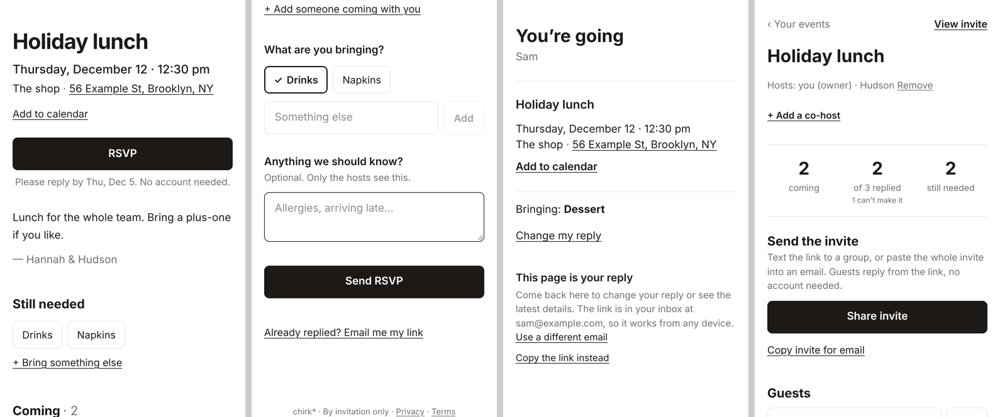
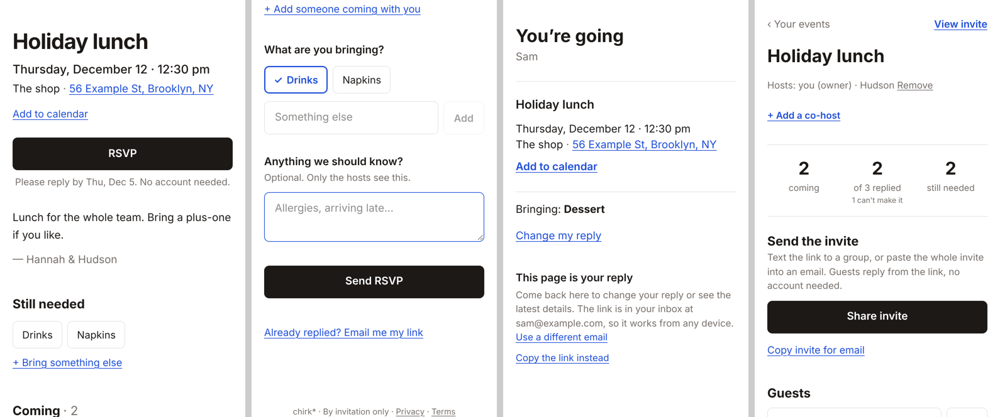
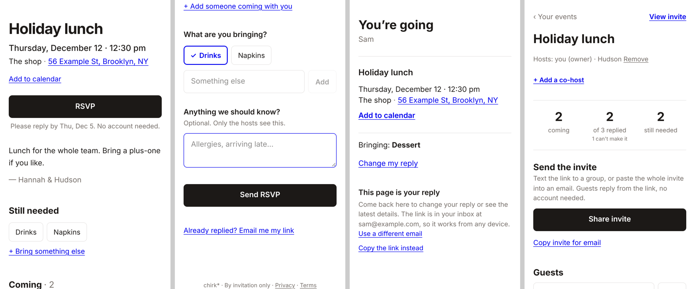
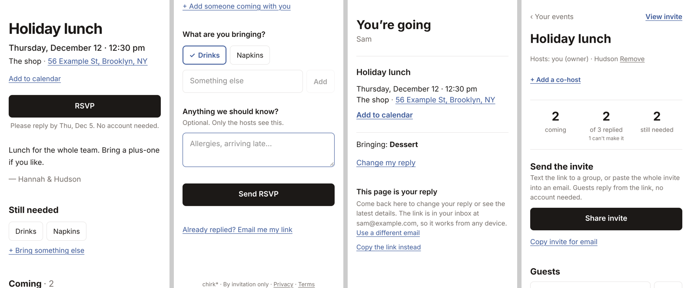

# chirk: one look, one vocabulary (Nov 20, 2026)

Parts 1 to 4 of Hudson's Nov 20 brief: the component audit, the action hierarchy, the brand-color comparison, newcomer language, the vocabulary audit, and a walk through the host side as Hannah would use it for a Flowers by Ford event. Read from the live code (main at `40fe9f7`) and checked on a local copy at iPhone size. Nothing here changes how RSVPs or any guest mechanics work.

## 1. Component audit (before this change)

The guest flow already followed `docs/CHIRK_UI_PATTERNS.md`. The host side still used the pre-v1 look. Counts are uses in the code.

| Concept | Where | Treatments found | Now |
|---|---|---|---|
| **Primary button** | Send RSVP, RSVP (guest); + New event, Save, Create event, Publish, Share invite, Email me a code, Sign in (host) | Two: `button` (8px, guest) and `btn` (black pill, 43 uses on host pages) | One: `button`. Used only for the one step that matters on a screen: RSVP / Send RSVP, Share invite (or Publish on a draft), Save / Create event, Email me a code / Sign in. **+ New event is now a link** beside the page title. |
| **Secondary button** | Add (beside fields), Email invite / reminder, Save ideas, Buy in all, Copy invite for email, Archive, Copy to next year, Save as a template | Three: `button-quiet` (outlined), `btn btn-quiet` (gray pill), `btn btn-quiet border bg-white` (white pill) | One: `button-quiet` for an action beside a field or a small group of sends. Page-level housekeeping (Copy to next year, Save as a template, Archive) became **links**. |
| **Text link** | Everywhere | Three: `link` (accent, guest), `underline underline-offset-2` (host, ~25), bold underlined buttons | One: `link` (+ `tap` for a 44px target). Only the footer and a few gray in-sentence links stay plain underline. |
| **Chips** | Still needed items, audience pick (Message your guests), templates, bring-list editor, Copy email / link / reminder, bulk actions | Three: `choice`, `pill` (filled black when picked), dashed `rounded-full` spans, `bg-wash` pills | Things you pick are `choice` (outline + ✓, never filled). Things you do are links or quiet buttons. Things you only read are plain text ("Still needed: Drinks · Napkins"). |
| **Checkbox chips** | Split between (costs), Buy-in / Cash-out, Who's in (gifts) | `pill-check` (black fill when on) | `choice-check`: the same look as `choice`, still a real checkbox the form posts. |
| **Cards / boxes** | Send the invite, Message your guests, stat tiles, terms notice, name prompt, archived notice, Save as a template, GuestSend panel, settle-up rows, gift schedule, Buy in all | `rounded-2xl bg-wash` (20 uses) and `rounded-2xl border` (event rows, place suggestions, preview) | Gone. Sections are a heading, space and hairlines. Boxes stay only where containment means something: alerts (amber/red, 8px) and the gift-exchange secret. |
| **Inputs** | All forms | 14px corners on host, 8px on guest | 8px everywhere, accent border on focus. |
| **Section headers** | Host page | h2 20px bold, but Send the invite and Message your guests were 17px inside boxes | All host sections are h2 20px bold. |
| **List rows** | Your events, guests, Your plans | Already hairline lists | Kept. The note bubble on a guest row became the guest-side soft italic quote. |
| **Status labels** | Your events (Live / Draft badges), guest rows (Host badge) | Colored pill badges | Words: "· Draft" after the title, Live says nothing, "· Host" in soft text. Green still means Going and nothing else. |
| **Stat tiles** | Host page (2 to 6 tiles) | Gray boxes | Same numbers in one row between hairlines. |
| **Host navigation** | ‹ Your events / View event, black "Back to host page" bar on the invite | Mixed | ‹ Your events (soft) and **View invite** (link). The bar on the invite is now a plain hairline row. |
| **Email CTAs** | 7 emails | 7 copies of an inline black pill (999px) | One shared `button()` in `src/lib/email-parts.ts`, 8px corners like the site. The message email's gray details box is now hairlines. |
| **RSVP CTAs** | Invite, pinned bar, named reply | Already v1 | Unchanged. |

**Token setup.** `src/app/globals.css` already had the right shape: ink, soft, line and one `--color-accent` used by links, focus and picked choices. The smallest coherent change was to retire the old utilities (`btn`, `btn-quiet`, `pill`, `pill-check`, `--color-wash`) and turn the v1 rules on for every page instead of only pages marked `guest`. The brand color is still one value. The guard test (`src/lib/patterns.test.mts`) now checks every screen, host pages included.

## 2. Action hierarchy

| Level | Looks | Where |
|---|---|---|
| **Primary** | ink fill, 8px corners, full width on phones | One per screen when there's a real next step: RSVP, Send RSVP, Share invite (live) or Publish (draft), Save / Create event, Email me a code |
| **Secondary** | white, hairline outline, 8px | Beside a field (Add, Send, Save) or a small set of sends (Email invite, Email reminder, Send update) |
| **Link** | accent text, underlined | Navigation and light actions: Add to calendar, Change my reply, View invite, + New event, Copy invite for email, Copy their link, Edit reply, Copy to next year, Archive |
| **Destructive** | soft gray underlined text, then a red **Sure?** | Remove, Delete this event. Quiet until tapped. |

The event host page has two primaries far apart (Share invite at the top, Save at the bottom of the event form). That's deliberate: Save belongs to the form. Everything else on that page is a link or a quiet button.

## 3. Brand color: three options

Rendered on the real screens (invite, RSVP with a picked item and a focused field, confirmation, host page). The primary button stays ink in all three, so color only ever means "you can tap this" or "this is picked". Emails would follow the same choice.

| | **A. Monochrome (today)** `#1c1917` | **B. chirk blue** `#1F4FD8` (6.6:1 on white) | **C. Link blue** `#0000EE` (9.4:1) |
|---|---|---|---|
| Links | ink, underlined | blue, underlined | classic blue, underlined |
| Focus ring | ink | blue | blue |
| Picked choices | ink outline + ✓ | blue outline + ✓ | blue outline + ✓ |
| Primary action | ink | ink | ink |
| Wordmark / spark | ink | the `*` in blue, the word in ink | the `*` in blue |
| Emails | ink button, gray links | ink button, blue links | ink button, blue links |
| Picture |  |  |  |

**Decided Nov 20: slate blue `#3d5a99`** (6.7:1 on white), Hudson's call, a quieter cousin of B. Shipped for links, focus and picked choices; the primary stays ink. Emails, the wordmark and the spark are unchanged for now (ink).

The original recommendation was B. It keeps the early-web meaning (blue = a link) and reads as deliberate rather than default. Literal `#0000EE` is very saturated next to warm grays and looks like an unstyled page on phones. Monochrome works, but then links and plain bold text look alike on the host page, which is now mostly links. Whichever is picked is one line (`--color-accent`) plus one guard-test line.

## 4. Newcomer language: three facts, said once each

| Fact | Where it's said now |
|---|---|
| **No app, no password. Your link is your reply.** | Invite page, under RSVP: "Please reply by Thu, Dec 5. No account needed." (hidden once you've replied). Same line under the button in invite emails. Confirmation: **This page is your reply**. "Come back here to change your reply or see the latest details." Your RSVP email: "This link is your reply. Open it any time to change it or see the latest details." |
| **Change your mind any time from the same link.** | Confirmation (above), and the Change my reply link right under it. |
| **All your invites live at chirk.fyi/me.** | Emails chirk sends to a guest's own address: "Every invite you get, in one place: chirk.fyi/me". Sign-in: "See every invite you get in one place, and plan your own. You never need to sign in to reply to an invite." /me with only invites: "Your plans · Every invite you get, in one place." |

Not added: anything on the invite that advertises chirk, or an onboarding page.

## 5. Vocabulary: one term per concept

| Concept | Before | Now |
|---|---|---|
| A guest's status | Going / Can't make it / No reply yet, but **"Reply"** on Your events' invite list | Going / Can’t make it / No reply yet everywhere |
| Events you're invited to | "Invited" (Your events), "Your plans" (home page) | **Your plans** (both) |
| Taking a guest off the list | "Delete" (row), "Remove" (Select) | **Remove** (events are deleted, guests removed) |
| The guest-facing page | "View event" | **View invite** |
| A guest's reply link (host) | "Edit" | **Edit reply** |
| Sending one guest their invite | "Send ›" | **Send invite** (opens Email invite / Email reminder / copy options) |
| After replying | "Keep your link" | **This page is your reply** |
| Salutations | "Hi Sam," (messages, gift match) and "Hi Sam!" (reminders, gift ideas) | **Hi Sam,** in every email and the reminder text. "Hi Sam, you’re invited!" stays the one exclamation. |
| Feedback | Saving… → Saved ✓, Sending… → Sent ✓, Copied ✓, "…" on two poker buttons | Same system; the two "…" are now "Adding…". "Couldn't copy" uses the typographic apostrophe. |
| Sign-in | "Been invited to an event? You're invited to chirk." | **Sign in to chirk** |
| Wrong old password | "That's not it." | "That password isn't right." |

Already consistent and kept: RSVP, Your RSVP, Change my reply, Still needed, Covered, Add your own (the box label), Coming, Guests, Hosts, owner, co-host, Your events, Message your guests, Send update, By invitation only, Remind (as "Email a reminder…").

## 6. Hannah's walkthrough (a Flowers by Ford event)

What works on its own, and what still depends on knowing where to click. ⚠ = flagged, not changed (behavior or new feature).

1. **An email thread arrives.** She can forward it to `new@in.chirk.fyi` from her chirk email, or paste it under New event. ⚠ Both are behind the "Paste a text or screenshot" link on New event, and the forward address appears only after tapping it. Forwarding only works from the email her chirk account uses.
2. **She reviews the draft.** Opens from the "Draft ready" email or Your events (marked "· Draft"). The draft page now says what to do ("Only hosts can see a draft. Check the details below, then publish.") with Publish as the one button. ⚠ Details live behind rows (Basics, Message, Photo…); a newcomer has to tap each to check it. Fine for 6 rows.
3. **She adds guests.** "Sam sam@x.com, Lee lee@x.com" in one box works, but the format is only in the hint line. ⚠ For 30 coworkers that's the step most likely to go wrong; a "paste a list of emails" path would help (new mechanic, not built).
4. **She sends the invite.** Share invite (text) and Copy invite for email are right under the numbers. ⚠ Emailing every guest from chirk means Select → tick each guest → Email invite. There's no "tick all". This is the clearest "Hudson knows where to click" spot.
5. **Replies arrive.** The host page refreshes itself every 20 seconds. ⚠ Reply notices by email ("Email me when someone replies") are under More options › Guest options, off by default.
6. **She checks attendance.** The numbers row (coming, replied, still needed) and the guest list. Clear.
7. **Update or reminder.** Three reminder paths: automatic (in Reply by), "Email a reminder to the N who haven't replied", and per guest. Message your guests for updates. All visible on the host page.
8. **Copy, archive, reuse.** Links at the bottom: Copy to next year (as a draft), Save as a template, Archive. ⚠ "Copy to next year" reads oddly for a monthly work event; it moves the date 52 weeks later. Consider "Make a copy (as a draft)" once copies can pick a date.

Things a company event surfaces that chirk doesn't need yet: no roles beyond owner/co-host, no departments, no export. Not built, on purpose.

## 7. What changed, in one list

- Host pages, sign-in, New event, costs, poker and gifts moved to the v1 patterns (no pills, no gray boxes, hairlines, 8px corners).
- The v1 rules (focus ring, press feedback, wrapping, balanced headings) are on for every page.
- Wording in sections 4 and 5, on screens and in emails.
- Emails share one button, escaping and wrapper (`src/lib/email-parts.ts`) instead of seven copies.
- Guard test covers every screen; check script and baselines updated.
- Not changed: RSVP flow, what any button does, who gets which email, database.
